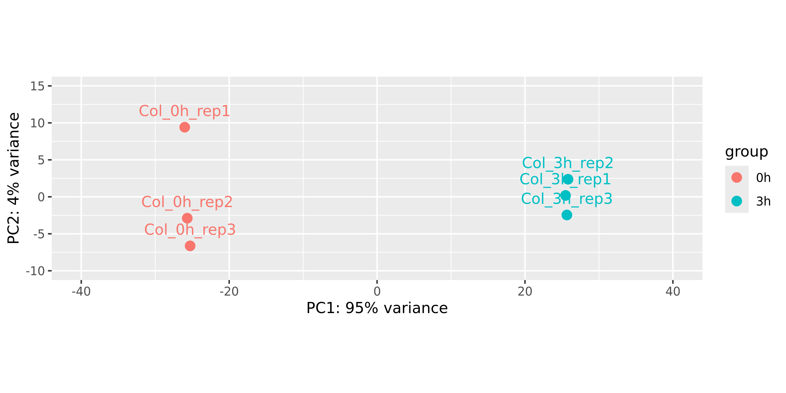
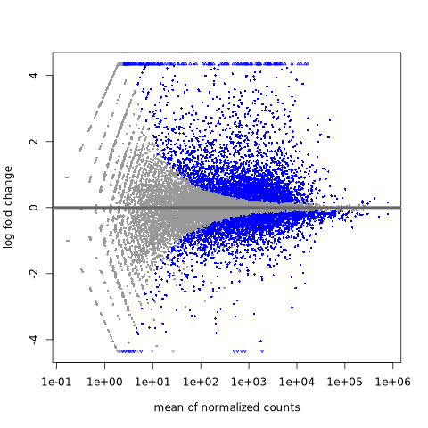
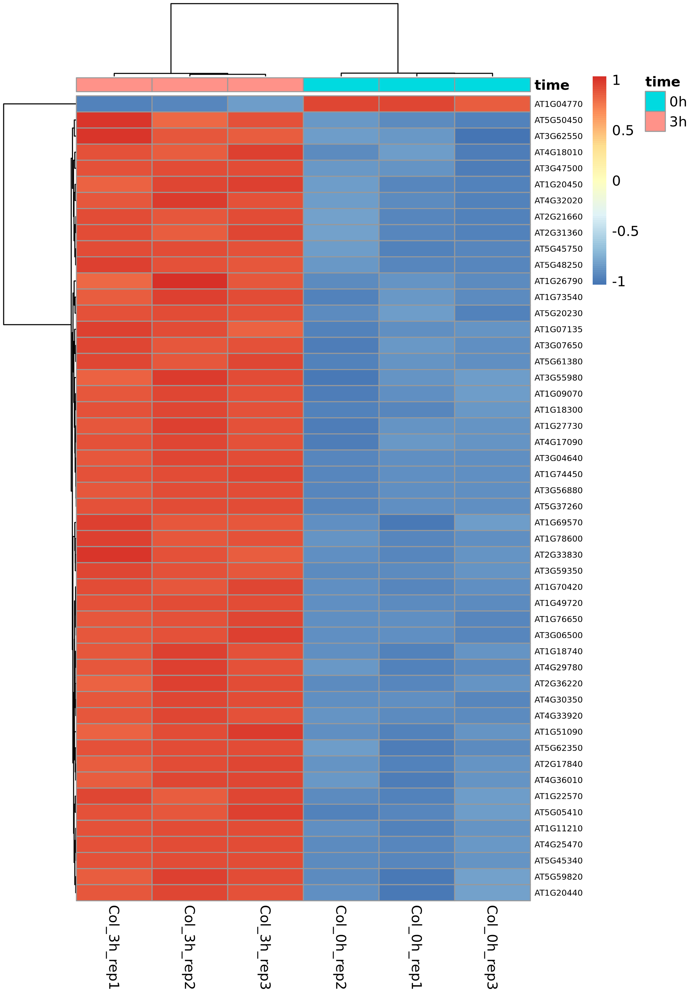

# Test 4: RNA-Seq Differential Expression (Option 1)

Name: Bryan Nsoh

Server: Sphinx

Repository URL: https://github.com/Bryan-Nsoh/EPP622-2026-RNASeq

Project folder: `/lustre/isaac24/proj/UTK0505/bnsoh/test4`

Course materials: https://github.com/ryandkuster/EPP_575_RNA_26/wiki

## Data

| Input | Path |
| --- | --- |
| Raw paired-end reads (BioProject PRJNA815365) | `/lustre/isaac24/proj/UTK0505/module4_rnaseq_data/data/raw/*.fastq.gz` |
| Arabidopsis TAIR10 genome | `/lustre/isaac24/proj/UTK0505/module4_rnaseq_data/data/reference/GCA_000001735.2_TAIR10.1_genomic.fna` |
| Annotation | `/lustre/isaac24/proj/UTK0505/module4_rnaseq_data/data/reference/genomic_modified.gff` |

## Samples

| Sample | Time | Replicate | SRA run |
| --- | --- | --- | --- |
| Col_0h_rep1 | 0h | rep1 | SRR18313928 |
| Col_0h_rep2 | 0h | rep2 | SRR18313927 |
| Col_0h_rep3 | 0h | rep3 | SRR18313918 |
| Col_3h_rep1 | 3h | rep1 | SRR18313902 |
| Col_3h_rep2 | 3h | rep2 | SRR18313922 |
| Col_3h_rep3 | 3h | rep3 | SRR18313921 |

## Setup

Description: 

```bash
#!/usr/bin/env bash
set -euo pipefail

DATA=/lustre/isaac24/proj/UTK0505/module4_rnaseq_data/data
cd /lustre/isaac24/proj/UTK0505/bnsoh/test4

mkdir -p data/reads data/reference scripts logs
mkdir -p results/0_sample_table results/1_qc_raw results/2_trimmed results/3_star_index results/4_mapping
mkdir -p results/5_counts results/6_deseq2 results/7_heatmap results/8_cold_genes

ln -sf $DATA/raw/*.fastq.gz data/reads/
ln -sf $DATA/raw/metadata.txt data/reads/
ln -sf $DATA/reference/GCA_000001735.2_TAIR10.1_genomic.fna data/reference/
ln -sf $DATA/reference/genomic_modified.gff data/reference/

cat > results/0_sample_table/samples.csv <<TABLE
sample,time,replicate,sra_run
Col_0h_rep1,0h,rep1,SRR18313928
Col_0h_rep2,0h,rep2,SRR18313927
Col_0h_rep3,0h,rep3,SRR18313918
Col_3h_rep1,3h,rep1,SRR18313902
Col_3h_rep2,3h,rep2,SRR18313922
Col_3h_rep3,3h,rep3,SRR18313921
TABLE
```

Order in which the scripts were run from the project folder:

```bash
cd /lustre/isaac24/proj/UTK0505/bnsoh/test4
conda activate rnaseq
bash scripts/00_setup.sh
bash scripts/01_qc_raw.sh > logs/01_qc_raw.log 2>&1
bash scripts/02_trim.sh > logs/02_trim.log 2>&1
bash scripts/03_star_index.sh > logs/03_star_index.log 2>&1
bash scripts/04_map.sh > logs/04_map.log 2>&1
bash scripts/05_count.sh > logs/05_count.log 2>&1
Rscript scripts/06_deseq2.R > logs/06_deseq2.log 2>&1
Rscript scripts/07_heatmap.R > logs/07_heatmap.log 2>&1
Rscript scripts/08_cold_genes.R > logs/08_cold_genes.log 2>&1
```

## Step 1: Raw Read QC (FastQC + MultiQC)

### Commands

Description: 

```bash
#!/usr/bin/env bash
set -euo pipefail

OUT=results/1_qc_raw

fastqc -t 12 --outdir $OUT data/reads/*.fastq.gz
multiqc -f $OUT -o $OUT
```

### Results

MultiQC report: `/lustre/isaac24/proj/UTK0505/bnsoh/test4/results/1_qc_raw/multiqc_report.html`


## Step 2: Trimming (fastp + FastQC + MultiQC)

### Commands

Description:

```bash
#!/usr/bin/env bash
set -euo pipefail

IN=data/reads
OUT=results/2_trimmed

for s in Col_0h_rep1 Col_0h_rep2 Col_0h_rep3 Col_3h_rep1 Col_3h_rep2 Col_3h_rep3; do
  fastp -w 16 --detect_adapter_for_pe --trim_poly_g \
    -i $IN/${s}_1.fastq.gz -I $IN/${s}_2.fastq.gz \
    -o $OUT/${s}_1.fastq.gz -O $OUT/${s}_2.fastq.gz \
    -h $OUT/$s.fastp.html -j $OUT/$s.fastp.json
done
fastqc -t 12 --outdir $OUT $OUT/*.fastq.gz
multiqc -f $OUT -o $OUT
```

### Results

MultiQC report: `/lustre/isaac24/proj/UTK0505/bnsoh/test4/results/2_trimmed/multiqc_report.html`

| Sample | Reads before (R1 + R2) | Reads after (R1 + R2) | % kept | Adapter-trimmed reads | Q30 before | Q30 after |
| --- | --- | --- | --- | --- | --- | --- |
| Col_0h_rep1 | 51,927,900 | 51,919,858 | 99.98% | 1,758,978 (3.39%) | 96.09% | 96.09% |
| Col_0h_rep2 | 52,775,746 | 52,765,778 | 99.98% | 1,850,530 (3.51%) | 96.53% | 96.54% |
| Col_0h_rep3 | 49,722,650 | 49,713,696 | 99.98% | 1,774,262 (3.57%) | 96.46% | 96.46% |
| Col_3h_rep1 | 53,778,178 | 53,769,974 | 99.98% | 1,879,844 (3.50%) | 96.05% | 96.05% |
| Col_3h_rep2 | 56,944,444 | 56,934,580 | 99.98% | 1,861,958 (3.27%) | 96.48% | 96.49% |
| Col_3h_rep3 | 50,109,358 | 50,100,082 | 99.98% | 1,683,086 (3.36%) | 96.25% | 96.26% |


## Step 3: STAR Index

### Commands

Description:

```bash
#!/usr/bin/env bash
set -euo pipefail

REF=data/reference
OUT=results/3_star_index

STAR --runMode genomeGenerate --runThreadN 16 \
  --genomeDir $OUT --outFileNamePrefix $OUT/ \
  --genomeFastaFiles $REF/GCA_000001735.2_TAIR10.1_genomic.fna \
  --sjdbGTFfile $REF/genomic_modified.gff --sjdbGTFtagExonParentTranscript Parent \
  --genomeSAindexNbases 12 --sjdbOverhang 149
```

### Results

Index: `/lustre/isaac24/proj/UTK0505/bnsoh/test4/results/3_star_index`


## Step 4: Mapping (STAR + samtools stats + MultiQC)

### Commands

Description:

```bash
#!/usr/bin/env bash
set -euo pipefail

IN=results/2_trimmed
INDEX=results/3_star_index
OUT=results/4_mapping

for s in Col_0h_rep1 Col_0h_rep2 Col_0h_rep3 Col_3h_rep1 Col_3h_rep2 Col_3h_rep3; do
  STAR --runThreadN 16 --genomeDir $INDEX \
    --readFilesIn $IN/${s}_1.fastq.gz $IN/${s}_2.fastq.gz --readFilesCommand zcat \
    --outSAMtype BAM SortedByCoordinate --outFileNamePrefix $OUT/$s.
  mv $OUT/$s.Aligned.sortedByCoord.out.bam $OUT/$s.bam
  samtools index $OUT/$s.bam
  samtools stats $OUT/$s.bam > $OUT/$s.stats.txt
done
multiqc -f $OUT -o $OUT
```

### Results

BAMs: `/lustre/isaac24/proj/UTK0505/bnsoh/test4/results/4_mapping/*.bam`

MultiQC report: `/lustre/isaac24/proj/UTK0505/bnsoh/test4/results/4_mapping/multiqc_report.html`

| Sample | Input read pairs | Uniquely mapped | Multi-mapped | Mapped to too many loci | Unmapped: too short | Unmapped: other |
| --- | --- | --- | --- | --- | --- | --- |
| Col_0h_rep1 | 25,959,929 | 98.45% | 1.10% | 0.00% | 0.45% | 0.00% |
| Col_0h_rep2 | 26,382,889 | 98.44% | 1.08% | 0.00% | 0.48% | 0.00% |
| Col_0h_rep3 | 24,856,848 | 98.42% | 1.10% | 0.00% | 0.47% | 0.00% |
| Col_3h_rep1 | 26,884,987 | 98.48% | 1.08% | 0.00% | 0.44% | 0.00% |
| Col_3h_rep2 | 28,467,290 | 98.55% | 1.01% | 0.00% | 0.43% | 0.00% |
| Col_3h_rep3 | 25,050,041 | 98.36% | 1.16% | 0.00% | 0.48% | 0.00% |


## Step 5: Read Counting (featureCounts)

### Commands

Description:

```bash
#!/usr/bin/env bash
set -euo pipefail

GFF=data/reference/genomic_modified.gff
OUT=results/5_counts

featureCounts -p -s 2 -T 16 -t gene -g ID -F GTF -a $GFF -o $OUT/counts.txt results/4_mapping/*.bam
multiqc -f results/4_mapping $OUT -o $OUT
```

### Results

Counts matrix: `/lustre/isaac24/proj/UTK0505/bnsoh/test4/results/5_counts/counts.txt`

MultiQC report (STAR + featureCounts): `/lustre/isaac24/proj/UTK0505/bnsoh/test4/results/5_counts/multiqc_report.html`

| Sample | Reads counted | Assigned | Unassigned: multi-mapping | Unassigned: no features | Unassigned: ambiguity |
| --- | --- | --- | --- | --- | --- |
| Col_0h_rep1 | 52,540,555 | 50,663,992 (96.43%) | 1,431,766 (2.73%) | 300,468 (0.57%) | 144,329 (0.27%) |
| Col_0h_rep2 | 53,373,596 | 51,489,085 (96.47%) | 1,437,556 (2.69%) | 297,533 (0.56%) | 149,422 (0.28%) |
| Col_0h_rep3 | 50,303,168 | 48,519,481 (96.45%) | 1,380,792 (2.74%) | 267,907 (0.53%) | 134,988 (0.27%) |
| Col_3h_rep1 | 54,387,154 | 52,413,190 (96.37%) | 1,440,403 (2.65%) | 388,360 (0.71%) | 145,201 (0.27%) |
| Col_3h_rep2 | 57,546,215 | 55,541,339 (96.52%) | 1,440,849 (2.50%) | 412,993 (0.72%) | 151,034 (0.26%) |
| Col_3h_rep3 | 50,699,340 | 48,770,656 (96.20%) | 1,427,724 (2.82%) | 367,322 (0.72%) | 133,638 (0.26%) |

#### Mapping summary

| Sample | % uniquely mapped (STAR) | % multi-mapped (STAR) | % unmapped (STAR) | % assigned to genes (featureCounts) | % no feature (featureCounts) |
| --- | --- | --- | --- | --- | --- |
| Col_0h_rep1 | 98.45% | 1.10% | 0.45% | 96.43% | 0.57% |
| Col_0h_rep2 | 98.44% | 1.08% | 0.48% | 96.47% | 0.56% |
| Col_0h_rep3 | 98.42% | 1.10% | 0.47% | 96.45% | 0.53% |
| Col_3h_rep1 | 98.48% | 1.08% | 0.44% | 96.37% | 0.71% |
| Col_3h_rep2 | 98.55% | 1.01% | 0.43% | 96.52% | 0.72% |
| Col_3h_rep3 | 98.36% | 1.16% | 0.48% | 96.20% | 0.72% |


## Step 6: Differential Expression (DESeq2)

### Commands

Description:

```r
library(DESeq2)
library(ggplot2)
setwd("results")

samples <- read.csv("0_sample_table/samples.csv", row.names = 1)
samples$time <- factor(samples$time)

fc <- read.delim("5_counts/counts.txt", comment.char = "#", row.names = 1, check.names = FALSE)
counts <- fc[, 6:ncol(fc)]
colnames(counts) <- sub(".bam", "", basename(colnames(counts)))
rownames(counts) <- sub("gene-", "", rownames(counts))
counts <- counts[, rownames(samples)]

dds <- DESeqDataSetFromMatrix(counts, samples, design = ~ time)
dds <- DESeq(dds)
res <- results(dds, contrast = c("time", "3h", "0h"), alpha = 0.05)

png("6_deseq2/MA_plot.png")
plotMA(res)
dev.off()

res <- as.data.frame(res)
res <- res[order(res$padj), ]
sig <- subset(res, padj < 0.05 & abs(log2FoldChange) >= 1)
write.csv(res, "6_deseq2/DE_all_genes.csv")
write.csv(sig, "6_deseq2/DE_significant_padj0.05_log2FC1.csv")

vsd <- vst(dds)
saveRDS(vsd, "6_deseq2/vsd.rds")
pca <- plotPCA(vsd, intgroup = "time") + geom_text(aes(label = name), vjust = -1, show.legend = FALSE)
ggsave("6_deseq2/PCA.png", pca + xlim(-40, 40) + ylim(-10, 15), width = 8, height = 4)
```

### Results

Significance thresholds: padj < 0.05 and |log2FC| >= 1. log2FC is 3h vs 0h (positive = higher at 3h).

All genes: `/lustre/isaac24/proj/UTK0505/bnsoh/test4/results/6_deseq2/DE_all_genes.csv`

Significant genes: `/lustre/isaac24/proj/UTK0505/bnsoh/test4/results/6_deseq2/DE_significant_padj0.05_log2FC1.csv`

| | Genes |
| --- | --- |
| Genes in counts matrix | 33,245 |
| Tested (padj not NA) | 22,967 |
| padj < 0.05 | 8,250 |
| padj < 0.05 and abs(log2FC) >= 1 | 1,575 |
| Up at 3h | 1,131 |
| Down at 3h | 444 |

Top 10 significant genes:

| Gene | baseMean | log2FC (3h vs 0h) | padj |
| --- | --- | --- | --- |
| AT4G25470 | 16,499 | 9.50 | 0 |
| AT1G11210 | 3,652 | 7.41 | 0 |
| AT1G76650 | 3,348 | 6.77 | 0 |
| AT5G37260 | 14,766 | 6.01 | 0 |
| AT1G22570 | 2,465 | 5.68 | 0 |
| AT1G51090 | 2,145 | 5.55 | 0 |
| AT1G27730 | 2,733 | 5.53 | 0 |
| AT1G07135 | 1,663 | 5.52 | 0 |
| AT4G29780 | 4,807 | 5.42 | 0 |
| AT5G20230 | 4,307 | 5.23 | 0 |

PCA (`/lustre/isaac24/proj/UTK0505/bnsoh/test4/results/6_deseq2/PCA.png`):



MA plot (`/lustre/isaac24/proj/UTK0505/bnsoh/test4/results/6_deseq2/MA_plot.png`):




## Step 7: Heatmap of Top 50 DE Genes (one step past)

### Commands

Description:

```r
library(DESeq2)
library(pheatmap)
setwd("results")

samples <- read.csv("0_sample_table/samples.csv", row.names = 1)
vsd <- readRDS("6_deseq2/vsd.rds")
sig <- read.csv("6_deseq2/DE_significant_padj0.05_log2FC1.csv", row.names = 1)
top50 <- head(rownames(sig), 50)

pheatmap(assay(vsd)[top50, ], scale = "row", annotation_col = samples["time"], fontsize_row = 6,
         filename = "7_heatmap/top50_DE_genes_heatmap.png", width = 7, height = 10)
```

### Results

Heatmap: `/lustre/isaac24/proj/UTK0505/bnsoh/test4/results/7_heatmap/top50_DE_genes_heatmap.png`




## Step 8: COR and CBF Genes

### Commands

Description:

```r
setwd("results")

res <- read.csv("6_deseq2/DE_all_genes.csv", row.names = 1)

cold <- c(CBF1 = "AT4G25490", CBF2 = "AT4G25470", CBF3 = "AT4G25480",
          COR15A = "AT2G42540", COR15B = "AT2G42530", COR47 = "AT1G20440",
          COR78 = "AT5G52310", COR6.6 = "AT5G15970", COR413 = "AT2G15970")

cold_genes <- res[cold, c("baseMean", "log2FoldChange", "padj")]
cold_genes$name <- names(cold)
write.csv(cold_genes, "8_cold_genes/COR_CBF_log2FC.csv")
```

### Results

COR/CBF table: `/lustre/isaac24/proj/UTK0505/bnsoh/test4/results/8_cold_genes/COR_CBF_log2FC.csv`

| Gene | ID | baseMean | log2FC (3h vs 0h) | padj | Direction | Significant |
| --- | --- | --- | --- | --- | --- | --- |
| CBF1 | AT4G25490 | 7,923 | 9.39 | 1.6e-87 | up | yes |
| CBF2 | AT4G25470 | 16,499 | 9.50 | 0 | up | yes |
| CBF3 | AT4G25480 | 12,194 | 9.64 | 7.4e-110 | up | yes |
| COR15A | AT2G42540 | 7,486 | 1.55 | 1.8e-11 | up | yes |
| COR15B | AT2G42530 | 3,744 | 3.94 | 2.9e-44 | up | yes |
| COR47 | AT1G20440 | 30,874 | 2.22 | 1.1e-313 | up | yes |
| COR78 | AT5G52310 | 9,114 | 1.85 | 2.3e-109 | up | yes |
| COR6.6 | AT5G15970 | 8,718 | 1.05 | 1.0e-44 | up | yes |
| COR413 | AT2G15970 | 13,265 | 0.57 | 3.4e-19 | up | no |


## Reflection

### 1. Within your list of top DEGs, what is the log 2 fold expression between normal and cold stress for COR and CBF? (See figure 9 in the paper) Are the COR and CBF up or down regulated in the cold stressed samples?

Answer:


### 2. Walk through your mapping QC and featureCounts output. What fraction of reads mapped uniquely? What percent of reads are unmapped, multimapping and no feature? What do each of these categories mean? Is anything in those numbers a red flag, and how would you know?

Answer:


### 3. Look at your PCA or sample-distance plot. Do the samples group by treatment? If a replicate misbehaves in an RNASeq analysis, what would you do about it in a real project and what are the consequences of dropping it?

Answer:


### 4. Counting reads per gene requires an annotation. Name one specific way your annotation choice (its completeness, how it handles isoforms, how reads on feature boundaries are assigned) could change which genes come out significant.

Answer:


## Directory structure

From `/lustre/isaac24/proj/UTK0505/bnsoh/test4` (`tree -I multiqc_data`):

```
.
├── data
│   ├── reads
│   │   ├── Col_0h_rep1_1.fastq.gz -> /lustre/isaac24/proj/UTK0505/module4_rnaseq_data/data/raw/Col_0h_rep1_1.fastq.gz
│   │   ├── Col_0h_rep1_2.fastq.gz -> /lustre/isaac24/proj/UTK0505/module4_rnaseq_data/data/raw/Col_0h_rep1_2.fastq.gz
│   │   ├── Col_0h_rep2_1.fastq.gz -> /lustre/isaac24/proj/UTK0505/module4_rnaseq_data/data/raw/Col_0h_rep2_1.fastq.gz
│   │   ├── Col_0h_rep2_2.fastq.gz -> /lustre/isaac24/proj/UTK0505/module4_rnaseq_data/data/raw/Col_0h_rep2_2.fastq.gz
│   │   ├── Col_0h_rep3_1.fastq.gz -> /lustre/isaac24/proj/UTK0505/module4_rnaseq_data/data/raw/Col_0h_rep3_1.fastq.gz
│   │   ├── Col_0h_rep3_2.fastq.gz -> /lustre/isaac24/proj/UTK0505/module4_rnaseq_data/data/raw/Col_0h_rep3_2.fastq.gz
│   │   ├── Col_3h_rep1_1.fastq.gz -> /lustre/isaac24/proj/UTK0505/module4_rnaseq_data/data/raw/Col_3h_rep1_1.fastq.gz
│   │   ├── Col_3h_rep1_2.fastq.gz -> /lustre/isaac24/proj/UTK0505/module4_rnaseq_data/data/raw/Col_3h_rep1_2.fastq.gz
│   │   ├── Col_3h_rep2_1.fastq.gz -> /lustre/isaac24/proj/UTK0505/module4_rnaseq_data/data/raw/Col_3h_rep2_1.fastq.gz
│   │   ├── Col_3h_rep2_2.fastq.gz -> /lustre/isaac24/proj/UTK0505/module4_rnaseq_data/data/raw/Col_3h_rep2_2.fastq.gz
│   │   ├── Col_3h_rep3_1.fastq.gz -> /lustre/isaac24/proj/UTK0505/module4_rnaseq_data/data/raw/Col_3h_rep3_1.fastq.gz
│   │   ├── Col_3h_rep3_2.fastq.gz -> /lustre/isaac24/proj/UTK0505/module4_rnaseq_data/data/raw/Col_3h_rep3_2.fastq.gz
│   │   └── metadata.txt -> /lustre/isaac24/proj/UTK0505/module4_rnaseq_data/data/raw/metadata.txt
│   └── reference
│       ├── GCA_000001735.2_TAIR10.1_genomic.fna -> /lustre/isaac24/proj/UTK0505/module4_rnaseq_data/data/reference/GCA_000001735.2_TAIR10.1_genomic.fna
│       └── genomic_modified.gff -> /lustre/isaac24/proj/UTK0505/module4_rnaseq_data/data/reference/genomic_modified.gff
├── logs
│   ├── 01_qc_raw.log
│   ├── 02_trim.log
│   ├── 03_star_index.log
│   ├── 04_map.log
│   ├── 05_count.log
│   ├── 06_deseq2.log
│   ├── 07_heatmap.log
│   └── 08_cold_genes.log
├── results
│   ├── 0_sample_table
│   │   └── samples.csv
│   ├── 1_qc_raw
│   │   ├── Col_0h_rep1_1_fastqc.html
│   │   ├── Col_0h_rep1_1_fastqc.zip
│   │   ├── Col_0h_rep1_2_fastqc.html
│   │   ├── Col_0h_rep1_2_fastqc.zip
│   │   ├── Col_0h_rep2_1_fastqc.html
│   │   ├── Col_0h_rep2_1_fastqc.zip
│   │   ├── Col_0h_rep2_2_fastqc.html
│   │   ├── Col_0h_rep2_2_fastqc.zip
│   │   ├── Col_0h_rep3_1_fastqc.html
│   │   ├── Col_0h_rep3_1_fastqc.zip
│   │   ├── Col_0h_rep3_2_fastqc.html
│   │   ├── Col_0h_rep3_2_fastqc.zip
│   │   ├── Col_3h_rep1_1_fastqc.html
│   │   ├── Col_3h_rep1_1_fastqc.zip
│   │   ├── Col_3h_rep1_2_fastqc.html
│   │   ├── Col_3h_rep1_2_fastqc.zip
│   │   ├── Col_3h_rep2_1_fastqc.html
│   │   ├── Col_3h_rep2_1_fastqc.zip
│   │   ├── Col_3h_rep2_2_fastqc.html
│   │   ├── Col_3h_rep2_2_fastqc.zip
│   │   ├── Col_3h_rep3_1_fastqc.html
│   │   ├── Col_3h_rep3_1_fastqc.zip
│   │   ├── Col_3h_rep3_2_fastqc.html
│   │   ├── Col_3h_rep3_2_fastqc.zip
│   │   └── multiqc_report.html
│   ├── 2_trimmed
│   │   ├── Col_0h_rep1.fastp.html
│   │   ├── Col_0h_rep1.fastp.json
│   │   ├── Col_0h_rep1_1.fastq.gz
│   │   ├── Col_0h_rep1_1_fastqc.html
│   │   ├── Col_0h_rep1_1_fastqc.zip
│   │   ├── Col_0h_rep1_2.fastq.gz
│   │   ├── Col_0h_rep1_2_fastqc.html
│   │   ├── Col_0h_rep1_2_fastqc.zip
│   │   ├── Col_0h_rep2.fastp.html
│   │   ├── Col_0h_rep2.fastp.json
│   │   ├── Col_0h_rep2_1.fastq.gz
│   │   ├── Col_0h_rep2_1_fastqc.html
│   │   ├── Col_0h_rep2_1_fastqc.zip
│   │   ├── Col_0h_rep2_2.fastq.gz
│   │   ├── Col_0h_rep2_2_fastqc.html
│   │   ├── Col_0h_rep2_2_fastqc.zip
│   │   ├── Col_0h_rep3.fastp.html
│   │   ├── Col_0h_rep3.fastp.json
│   │   ├── Col_0h_rep3_1.fastq.gz
│   │   ├── Col_0h_rep3_1_fastqc.html
│   │   ├── Col_0h_rep3_1_fastqc.zip
│   │   ├── Col_0h_rep3_2.fastq.gz
│   │   ├── Col_0h_rep3_2_fastqc.html
│   │   ├── Col_0h_rep3_2_fastqc.zip
│   │   ├── Col_3h_rep1.fastp.html
│   │   ├── Col_3h_rep1.fastp.json
│   │   ├── Col_3h_rep1_1.fastq.gz
│   │   ├── Col_3h_rep1_1_fastqc.html
│   │   ├── Col_3h_rep1_1_fastqc.zip
│   │   ├── Col_3h_rep1_2.fastq.gz
│   │   ├── Col_3h_rep1_2_fastqc.html
│   │   ├── Col_3h_rep1_2_fastqc.zip
│   │   ├── Col_3h_rep2.fastp.html
│   │   ├── Col_3h_rep2.fastp.json
│   │   ├── Col_3h_rep2_1.fastq.gz
│   │   ├── Col_3h_rep2_1_fastqc.html
│   │   ├── Col_3h_rep2_1_fastqc.zip
│   │   ├── Col_3h_rep2_2.fastq.gz
│   │   ├── Col_3h_rep2_2_fastqc.html
│   │   ├── Col_3h_rep2_2_fastqc.zip
│   │   ├── Col_3h_rep3.fastp.html
│   │   ├── Col_3h_rep3.fastp.json
│   │   ├── Col_3h_rep3_1.fastq.gz
│   │   ├── Col_3h_rep3_1_fastqc.html
│   │   ├── Col_3h_rep3_1_fastqc.zip
│   │   ├── Col_3h_rep3_2.fastq.gz
│   │   ├── Col_3h_rep3_2_fastqc.html
│   │   ├── Col_3h_rep3_2_fastqc.zip
│   │   └── multiqc_report.html
│   ├── 3_star_index
│   │   ├── Genome
│   │   ├── Log.out
│   │   ├── SA
│   │   ├── SAindex
│   │   ├── chrLength.txt
│   │   ├── chrName.txt
│   │   ├── chrNameLength.txt
│   │   ├── chrStart.txt
│   │   ├── exonGeTrInfo.tab
│   │   ├── exonInfo.tab
│   │   ├── geneInfo.tab
│   │   ├── genomeParameters.txt
│   │   ├── sjdbInfo.txt
│   │   ├── sjdbList.fromGTF.out.tab
│   │   ├── sjdbList.out.tab
│   │   └── transcriptInfo.tab
│   ├── 4_mapping
│   │   ├── Col_0h_rep1.Log.final.out
│   │   ├── Col_0h_rep1.Log.out
│   │   ├── Col_0h_rep1.Log.progress.out
│   │   ├── Col_0h_rep1.SJ.out.tab
│   │   ├── Col_0h_rep1.bam
│   │   ├── Col_0h_rep1.bam.bai
│   │   ├── Col_0h_rep1.stats.txt
│   │   ├── Col_0h_rep2.Log.final.out
│   │   ├── Col_0h_rep2.Log.out
│   │   ├── Col_0h_rep2.Log.progress.out
│   │   ├── Col_0h_rep2.SJ.out.tab
│   │   ├── Col_0h_rep2.bam
│   │   ├── Col_0h_rep2.bam.bai
│   │   ├── Col_0h_rep2.stats.txt
│   │   ├── Col_0h_rep3.Log.final.out
│   │   ├── Col_0h_rep3.Log.out
│   │   ├── Col_0h_rep3.Log.progress.out
│   │   ├── Col_0h_rep3.SJ.out.tab
│   │   ├── Col_0h_rep3.bam
│   │   ├── Col_0h_rep3.bam.bai
│   │   ├── Col_0h_rep3.stats.txt
│   │   ├── Col_3h_rep1.Log.final.out
│   │   ├── Col_3h_rep1.Log.out
│   │   ├── Col_3h_rep1.Log.progress.out
│   │   ├── Col_3h_rep1.SJ.out.tab
│   │   ├── Col_3h_rep1.bam
│   │   ├── Col_3h_rep1.bam.bai
│   │   ├── Col_3h_rep1.stats.txt
│   │   ├── Col_3h_rep2.Log.final.out
│   │   ├── Col_3h_rep2.Log.out
│   │   ├── Col_3h_rep2.Log.progress.out
│   │   ├── Col_3h_rep2.SJ.out.tab
│   │   ├── Col_3h_rep2.bam
│   │   ├── Col_3h_rep2.bam.bai
│   │   ├── Col_3h_rep2.stats.txt
│   │   ├── Col_3h_rep3.Log.final.out
│   │   ├── Col_3h_rep3.Log.out
│   │   ├── Col_3h_rep3.Log.progress.out
│   │   ├── Col_3h_rep3.SJ.out.tab
│   │   ├── Col_3h_rep3.bam
│   │   ├── Col_3h_rep3.bam.bai
│   │   ├── Col_3h_rep3.stats.txt
│   │   └── multiqc_report.html
│   ├── 5_counts
│   │   ├── counts.txt
│   │   ├── counts.txt.summary
│   │   └── multiqc_report.html
│   ├── 6_deseq2
│   │   ├── DE_all_genes.csv
│   │   ├── DE_significant_padj0.05_log2FC1.csv
│   │   ├── MA_plot.png
│   │   ├── PCA.png
│   │   └── vsd.rds
│   ├── 7_heatmap
│   │   └── top50_DE_genes_heatmap.png
│   └── 8_cold_genes
│       └── COR_CBF_log2FC.csv
└── scripts
    ├── 00_setup.sh
    ├── 01_qc_raw.sh
    ├── 02_trim.sh
    ├── 03_star_index.sh
    ├── 04_map.sh
    ├── 05_count.sh
    ├── 06_deseq2.R
    ├── 07_heatmap.R
    └── 08_cold_genes.R
15 directories, 176 files
```
